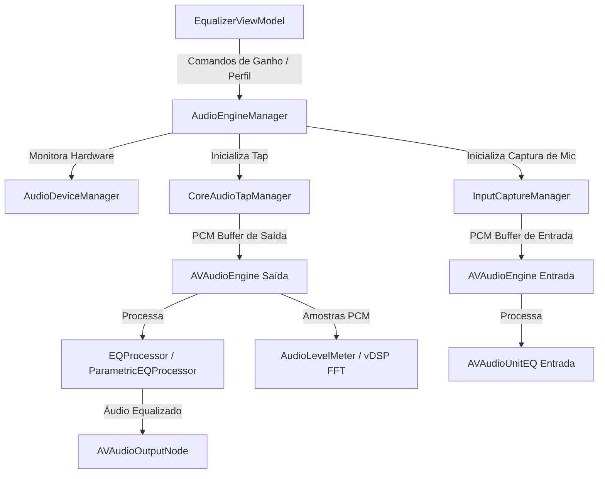

# Audio Engine - Input & Output Design

**Spec**: `.specs/features/audio-engine/spec.md`
**Status**: Approved

---

## Architecture Overview

O Motor de Áudio é modularizado em componentes especialistas de baixo nível (`CoreAudioTapManager`, `AudioDeviceManager`, `InputCaptureManager`) orquestrados por um controlador central de alto nível (`AudioEngineManager`). A equalização em tempo real é executada através de duas instâncias especializadas de nós: `EQProcessor` (para equalização gráfica de 10 bandas fixa) e `ParametricEQProcessor` (para equalização dinâmica N-bandas com perfis como AutoEQ).



---

## Code Reuse Analysis

### Existing Components to Leverage

| Component | Location | How to Use |
|-----------|----------|------------|
| `AudioHardwareCreateProcessTap` | `CoreAudio` | API nativa em C da Apple no macOS 14.2+ para interceptar streams de áudio sem instalar Virtual Audio Drivers (como BlackHole). |
| `AVAudioUnitEQ` | `AVFAudio` | Nó DSP nativo altamente otimizado em C++/Assembly pela Apple que suporta N bandas com filtros biquad paramétricos. |
| `vDSP_fft_zrip` | `Accelerate` | Computação vetorial ultrarrápida (FFT) para gerar espectro visual e medidores de volume em tempo real com consumo irrisório de CPU. |

---

## Components

### `AudioDeviceManager`

- **Purpose**: Enumera dispositivos de áudio físicos de entrada e saída do macOS e escuta eventos de troca padrão (`kAudioHardwarePropertyDefaultOutputDevice`).
- **Location**: `Equalizer/Audio/AudioDeviceManager.swift`
- **Interfaces**:
  - `var outputDevices: [AudioDevice] { get }`
  - `var inputDevices: [AudioDevice] { get }`
  - `var defaultOutputDevice: AudioDevice? { get }`
  - `var defaultInputDevice: AudioDevice? { get }`
  - `func startListeningForDeviceChanges(onChange: @escaping () -> Void)`
- **Dependencies**: `CoreAudio` (`AudioObjectGetPropertyData`, `AudioObjectAddPropertyListener`).

### `CoreAudioTapManager`

- **Purpose**: Cria, anexa e gerencia o `Process Tap` no dispositivo primário de saída usando a API `AudioHardwareCreateProcessTap`.
- **Location**: `Equalizer/Audio/CoreAudioTapManager.swift`
- **Interfaces**:
  - `func createTap(for deviceID: AudioObjectID) throws -> AudioObjectID`
  - `func destroyTap()`
  - `var isTapActive: Bool { get }`
- **Dependencies**: `CoreAudio`.

### `EQProcessor` & `ParametricEQProcessor`

- **Purpose**: Encapsulam instâncias de `AVAudioUnitEQ` no engine, convertendo estruturas de modelo (`EQBand`, `HeadphoneProfile`) em parâmetros de filtro nativos.
- **Location**: `Equalizer/Audio/EQProcessor.swift` & `ParametricEQProcessor.swift`
- **Interfaces**:
  - `var eqNode: AVAudioUnitEQ { get }`
  - `func updateBandGain(index: Int, gain: Float)`
  - `func updateGlobalGain(_ gain: Float)`
  - `func loadProfile(_ profile: HeadphoneProfile)`
- **Dependencies**: `AVFAudio` (`AVAudioUnitEQ`, `AVAudioUnitEQFilterParameters`).

### `AudioEngineManager`

- **Purpose**: Orquestrador master que conecta os nós do `AVAudioEngine`, lida com o ciclo de vida (`start/stop/pause`) e expõe métodos limpos para a camada de UI.
- **Location**: `Equalizer/Audio/AudioEngineManager.swift`
- **Interfaces**:
  - `static let shared = AudioEngineManager()`
  - `var isRunning: Bool { get }`
  - `func startEngine() throws`
  - `func stopEngine()`
  - `func setBypass(_ bypassed: Bool)`
- **Dependencies**: `AVFAudio`, `CoreAudioTapManager`, `AudioDeviceManager`.

---

## Data Models

### `AudioDevice`

```swift
struct AudioDevice: Identifiable, Equatable {
    let id: AudioObjectID
    let uid: String
    let name: String
    let isOutput: Bool
    let isInput: Bool
    let sampleRate: Double
}
```

---

## Error Handling Strategy

| Error Scenario | Handling | User Impact |
|----------------|----------|-------------|
| Erro `kAudioHardwareNotRunningError` ou falha ao anexar o Tap | Retentativa exponencial (`Retry 1s -> 2s`) e notificação via delegate/publisher para que o `EqualizerViewModel` mostre status visual. | O ícone no notch mostra aviso amarelo; áudio original continua tocando sem corte repentino. |
| Permissão de gravação negada pelo usuário (`AVAudioSession` / `macOS TCC`) | Identificação prévia com `AVCaptureDevice.authorizationStatus(for: .audio)`. Se `.denied`, exibe prompt de permissão na janela do notch. | Usuário é instruído de forma amigável a habilitar a permissão em Ajustes do Sistema. |

---

## Tech Decisions

| Decision | Choice | Rationale |
|----------|--------|-----------|
| **Interceptação de Saída** | `AudioHardwareCreateProcessTap` (API 14.2+) | É a única forma suportada e nativa de equalizar o áudio geral do macOS sem obrigar o usuário a instalar extensões de kernel (kexts) de terceiros, garantindo leveza e aprovação na App Store. |
| **Pipeline de Processamento** | `AVAudioEngine` + `AVAudioUnitEQ` | Evita re-implementar filtros biquad manuais em C/C++, delegando o processamento pesado de precisão de 64 bits em ponto flutuante diretamente para os aceleradores de hardware otimizados pela Apple (`Accelerate/vDSP`). |
