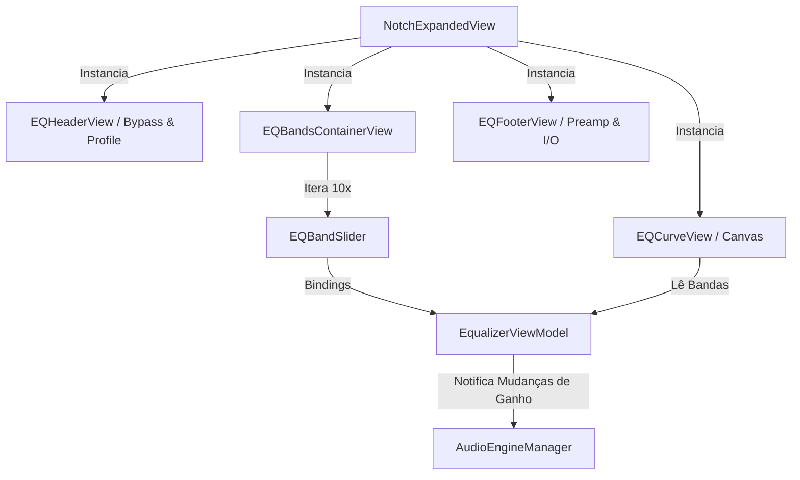

# Equalizer Interface Design

**Spec**: `.specs/features/equalizer-ui/spec.md`
**Status**: Approved

---

## Architecture Overview

A camada de interface do equalizador é centralizada no `EqualizerViewModel`, que atua como ponte entre a UI reativa (SwiftUI) e o motor de áudio (`AudioEngineManager`). As bandas de equalização são modeladas via `EQBand` e renderizadas modularmente pelo `EQBandSlider`. O `EQCurveView` lê o array de bandas e desenha a curva de resposta de frequência combinada utilizando a API `Canvas` do SwiftUI.



---

## Code Reuse Analysis

### Existing Components to Leverage

| Component | Location | How to Use |
|-----------|----------|------------|
| `Canvas` | `SwiftUI` | Renderização 2D acelerada via GPU para desenhar a curva contínua logarítmica das frequências sem instanciar centenas de sub-views. |
| `DragGesture` | `SwiftUI` | Gestão de arrasto vertical nos sliders personalizados para controle fino de dB. |
| `VisualEffectView` | `AppKit / SwiftUI` | Superfícies de fundo com desfoque nativo do sistema para destacar os elementos de controle. |

---

## Components

### `EQBandSlider`

- **Purpose**: Componente de slider vertical customizado para uma única banda, exibindo indicador de nível, texto de ganho em dB e rótulo de frequência no rodapé.
- **Location**: `Equalizer/Views/EQBandSlider.swift`
- **Interfaces**:
  - `init(band: Binding<EQBand>, range: ClosedRange<Float>, onReset: @escaping () -> Void)`
- **Dependencies**: `SwiftUI`, `Color+Theme`.

### `EQCurveView`

- **Purpose**: Renderiza no fundo da interface a curva contínua de resposta do equalizador, calculando a interpolação de Bézier entre os pontos de ganho das bandas.
- **Location**: `Equalizer/Views/EQCurveView.swift`
- **Interfaces**:
  - `init(bands: [EQBand], preampGain: Float, isBypassed: Bool)`
- **Dependencies**: `SwiftUI` (`Canvas`).

### `EqualizerViewModel`

- **Purpose**: Mantém o estado reativo das 10 bandas do modo simples ou das N bandas do perfil paramétrico ativo, notificando o motor de áudio a cada ajuste.
- **Location**: `Equalizer/ViewModels/EqualizerViewModel.swift`
- **Interfaces**:
  - `@Published var bands: [EQBand]`
  - `@Published var preampGain: Float`
  - `@Published var isBypassed: Bool`
  - `@Published var selectedPreset: EQPreset?`
  - `@Published var selectedProfile: HeadphoneProfile?`
  - `func resetAllBands()`
  - `func updateBandGain(id: UUID, gain: Float)`
- **Dependencies**: `Combine`, `AudioEngineManager`.

---

## Data Models

### `EQFilterType`

```swift
enum EQFilterType: String, Codable, CaseIterable {
    case lowShelf = "LOW_SHELF"
    case peak = "PEAK"
    case highShelf = "HIGH_SHELF"
    case lowPass = "LOW_PASS"
    case highPass = "HIGH_PASS"
    case bandPass = "BAND_PASS"
    case notch = "NOTCH"
    
    var audioUnitFilterType: AVAudioUnitEQFilterType {
        switch self {
        case .lowShelf: return .parametric // ou resizableLowPass dependendo do Q
        case .peak: return .parametric
        case .highShelf: return .parametric
        case .lowPass: return .lowPass
        case .highPass: return .highPass
        case .bandPass: return .bandPass
        case .notch: return .notch
        }
    }
}
```

### `EQBand`

```swift
struct EQBand: Identifiable, Equatable, Codable {
    let id: UUID
    var filterType: EQFilterType
    var frequency: Float         // Hz (ex: 32.0, 64.0, 1000.0)
    var gain: Float              // dB (-30.0 a +30.0)
    var qFactor: Float           // Q (0.1 a 20.0)
    var bandwidth: Float         // BW em oitavas (0.01 a 10.0)
    var isEnabled: Bool
    
    static var defaultTenBands: [EQBand] {
        let freqs: [Float] = [32, 64, 125, 250, 500, 1000, 2000, 4000, 8000, 16000]
        return freqs.map { freq in
            EQBand(
                id: UUID(),
                filterType: freq == 32 ? .lowShelf : (freq == 16000 ? .highShelf : .peak),
                frequency: freq,
                gain: 0.0,
                qFactor: 1.414,
                bandwidth: 1.0,
                isEnabled: true
            )
        }
    }
}
```

---

## Error Handling Strategy

| Error Scenario | Handling | User Impact |
|----------------|----------|-------------|
| Valor numérico inválido ou `NaN` gerado por gesto em slider | O setter do `EQBand` aplica `clamping(-30.0, 30.0)` e proteção contra infinitos/NaN antes de enviar ao áudio. | O slider atinge o limite limpo de +15 dB ou -15 dB sem crash. |

---

## Tech Decisions

| Decision | Choice | Rationale |
|----------|--------|-----------|
| **Curva Interpolação** | Curva logarítmica em `Canvas` com interpolação Catmull-Rom ou Bézier | Como o ouvido humano percebe frequências de modo logarítmico, o espaçamento horizontal no gráfico deve seguir escala logarítmica (onde 100 Hz a 1 kHz ocupa o mesmo espaço visual que 1 kHz a 10 kHz). |
| **Cores e Estética** | Gradiente acentuado (`Visual Accent Gradient`) e escuro (`Dark Mode Only`) | O notch do Mac fica envolto na moldura preta da tela. Manter o app escuríssimo com toques de cor neon/vibrante para as bandas ativas garante coesão premium. |
