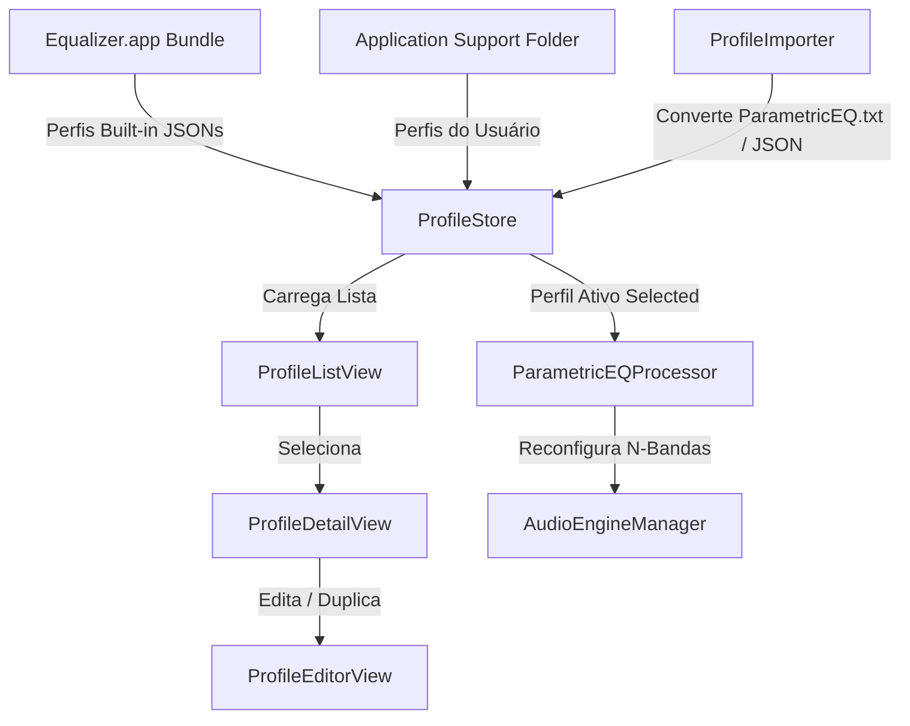

# Headphone Profiles & Presets Design

**Spec**: `.specs/features/headphone-profiles/spec.md`
**Status**: Approved

---

## Architecture Overview

O subsistema de Perfis de Fones é estruturado com uma separação clara entre os dados serializáveis em JSON (`HeadphoneProfile`, `ProfileBand`), a camada de persistência em disco (`ProfileStore`, `PresetStore`), e os processadores de parsing/conversão (`ProfileImporter`). A UI oferece três níveis de profundidade: seleção rápida no notch (`ProfilePicker`), gestão em painel (`ProfileListView` + `ProfileDetailView`) e edição tabular cirúrgica (`ProfileEditorView`).



---

## Code Reuse Analysis

### Existing Components to Leverage

| Component | Location | How to Use |
|-----------|----------|------------|
| `JSONDecoder / JSONEncoder` | `Foundation` | Decodificação e codificação ultrarrápida dos arquivos de perfis de fones com datas formatadas em ISO8601 e chaves ordenadas. |
| `FileManager` | `Foundation` | Gerenciamento seguro das pastas de usuário (`~/Library/Application Support/Equalizer/HeadphoneProfiles/`). |
| `UniformTypeIdentifiers (UTType)` | `Core` | Definição de tipos de arquivo para o seletor de importação (`.json` e `.txt` do AutoEQ). |

---

## Components

### `ProfileStore`

- **Purpose**: Classe observável responsável por ler os perfis embutidos no bundle e gerenciar os perfis customizados criados ou importados na pasta do usuário.
- **Location**: `Equalizer/Services/ProfileStore.swift`
- **Interfaces**:
  - `@Published var profiles: [HeadphoneProfile]`
  - `@Published var activeProfile: HeadphoneProfile?`
  - `func loadBuiltInProfiles()`
  - `func loadUserProfiles()`
  - `func saveProfile(_ profile: HeadphoneProfile) throws`
  - `func deleteProfile(_ profile: HeadphoneProfile) throws`
  - `func importProfile(from url: URL) throws -> HeadphoneProfile`
- **Dependencies**: `Foundation`, `Combine`, `ProfileImporter`.

### `ProfileImporter`

- **Purpose**: Conversor bidirecional que decodifica arquivos JSON e realiza parsing por expressões regulares no formato texto do AutoEQ (`ParametricEQ.txt`).
- **Location**: `Equalizer/Services/ProfileImporter.swift`
- **Interfaces**:
  - `func importFromJSON(url: URL) throws -> HeadphoneProfile`
  - `func exportToJSON(profile: HeadphoneProfile, to url: URL) throws`
  - `func importFromAutoEQ(text: String, brand: String, model: String) throws -> HeadphoneProfile`
- **Dependencies**: `Foundation`.

### `ProfileListView` & `ProfileDetailView`

- **Purpose**: Interfaces em SwiftUI para visualizar e interagir com os perfis agrupados por "Built-in" e "Meus Perfis", mostrando a tabela de bandas e metadados.
- **Location**: `Equalizer/Views/Profiles/ProfileListView.swift` & `ProfileDetailView.swift`
- **Interfaces**:
  - `init(store: ProfileStore)`
  - `init(profile: HeadphoneProfile, onActivate: () -> Void, onEdit: () -> Void)`
- **Dependencies**: `SwiftUI`, `ProfileStore`.

### `ProfileEditorView` & `BandEditorRow`

- **Purpose**: Formulário de edição inline e tabela dinâmica onde o usuário edita campos de Frequência, Ganho, Q-Factor, Bandwidth e adiciona/remove filtros do perfil.
- **Location**: `Equalizer/Views/Profiles/ProfileEditorView.swift` & `BandEditorRow.swift`
- **Interfaces**:
  - `init(profile: Binding<HeadphoneProfile>, onSave: (HeadphoneProfile) -> Void)`
- **Dependencies**: `SwiftUI`.

---

## Data Models

### `HeadphoneProfile` & `ProfileBand`

```swift
struct HeadphoneProfile: Identifiable, Codable, Equatable {
    let id: UUID
    var name: String                    // Ex: "Sony WH-1000XM4 — Harman Target (ANC ON)"
    var brand: String                   // Ex: "Sony"
    var model: String                   // Ex: "WH-1000XM4"
    var description: String
    var targetCurve: String             // Ex: "Harman 2019", "Harman IE 2019", "Balanced"
    var preampGain: Float               // Ganho de pré-amplificação (dB) ex: -5.6
    var bands: [ProfileBand]            // N bandas paramétricas
    var isBuiltIn: Bool
    var source: String?                 // Ex: "oratory1990", "AutoEQ", "Custom"
    var createdAt: Date
    var updatedAt: Date
    
    struct ProfileBand: Identifiable, Codable, Equatable {
        let id: UUID
        var filterType: EQFilterType
        var frequency: Float            // Hz (qualquer valor, ex: 105.0)
        var gain: Float                 // dB
        var qFactor: Float              // Q-Factor (ex: 0.71, 4.0)
        var bandwidth: Float            // BW em oitavas (ex: 1.89, 0.36)
        var isEnabled: Bool
        
        /// Converte Q para Bandwidth (oitavas)
        static func qToBandwidth(q: Float) -> Float {
            guard q > 0 else { return 1.0 }
            return 2.0 / log(2.0) * asinh(1.0 / (2.0 * q))
        }
        
        /// Converte Bandwidth para Q-Factor
        static func bandwidthToQ(bw: Float) -> Float {
            guard bw > 0 else { return 1.414 }
            return 1.0 / (2.0 * sinh(log(2.0) / 2.0 * bw))
        }
    }
}
```

---

## Error Handling Strategy

| Error Scenario | Handling | User Impact |
|----------------|----------|-------------|
| Arquivo de perfil JSON ausente na pasta do usuário durante a leitura | O `ProfileStore` ignora o arquivo com log de aviso (`OSLog`) e prossegue carregando os perfis built-in e os demais válidos. | App abre sem travar e exibe a lista limpa dos fones disponíveis. |
| Arquivo `ParametricEQ.txt` com sintaxe desconhecida ou incompleta | O `ProfileImporter` emite um `ProfileImportError.invalidFormat` pormenorizando a linha com falha de parsing. | Alerta visual no seletor de arquivos explicando o formato esperado. |

---

## Tech Decisions

| Decision | Choice | Rationale |
|----------|--------|-----------|
| **Estrutura Built-in** | JSONs separados no Bundle (`sony_wh1000xm4.json`, `kz_zsn_pro_x.json`, `huawei_freebuds_pro5.json`) | Manter os perfis pré-configurados em arquivos `.json` puros dentro da pasta `Resources/HeadphoneProfiles/` do Xcode permite atualizá-los ou adicionar novos fones sem precisar recompilar a lógica Swift da aplicação. |
| **Relação Q vs Bandwidth** | Ambos mantidos no JSON com métodos estáticos de conversão em tempo de execução | Enquanto o AutoEQ trabalha e exporta tanto com Q quanto com Bandwidth, os nós de áudio da Apple (`AVAudioUnitEQFilterParameters`) operam prioritariamente com `bandwidth` em oitavas. Manter a conversão bidirecional na struct garante que o usuário veja e edite os valores exatamente na convenção que preferir. |
