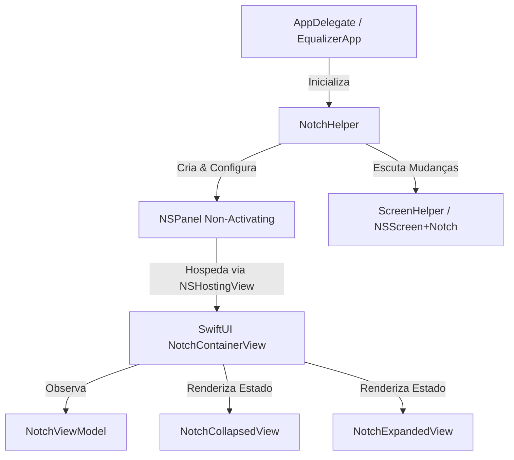

# Notch Window & Interface Base Design

**Spec**: `.specs/features/notch-window/spec.md`
**Status**: Approved

---

## Architecture Overview

O sistema de janela no notch é construído utilizando uma arquitetura híbrida de `AppKit` (para controle preciso de janela, nível Z, transparência e comportamento non-activating) com `SwiftUI` (para renderização declarativa, animações de transição e reatividade de estado). 

A classe `NotchHelper` instancia um `NSPanel` customizado configurado como um painel flutuante de sistema, abrigando um `NSHostingView` que renderiza a `NotchContainerView`. Um `NotchViewModel` reativo gerencia o ciclo de vida e a máquina de estados (`NotchState: collapsed | expanded`).



---

## Code Reuse Analysis

### Existing Components to Leverage

| Component | Location | How to Use |
|-----------|----------|------------|
| `NSPanel` | `AppKit` | Subclassing ou configuração de instância para overlay sem título e non-activating (`.nonactivatingPanel`). |
| `NSScreen` | `AppKit` | Extensão `NSScreen+Notch` para leitura de insets de safe area e detecção física do notch. |
| `NSVisualEffectView` | `AppKit / SwiftUI` | Uso do modificador `.background(Material.ultraThinMaterial)` para glassmorphism no macOS Sequoia. |

---

## Components

### `NSScreen+Notch` (`ScreenHelper.swift`)

- **Purpose**: Fornece propriedades calculadas para verificar se a tela ativa possui notch físico e obter seu bounding frame exato em coordenadas do AppKit.
- **Location**: `Equalizer/Helpers/ScreenHelper.swift`
- **Interfaces**:
  - `var hasNotch: Bool { get }` — Retorna `true` se `safeAreaInsets.top > 24`.
  - `var notchFrame: NSRect { get }` — Retorna o retângulo exato do notch ou área simulada no topo central.
  - `var notchSize: NSSize { get }` — Dimensões de largura e altura do notch físico.
- **Dependencies**: `AppKit` (`NSScreen`).

### `NotchHelper`

- **Purpose**: Gerencia o ciclo de vida e posicionamento do `NSPanel`, garantindo que ele flutue acima das janelas normais, participe de todos os Spaces e não roube o foco principal.
- **Location**: `Equalizer/Helpers/NotchHelper.swift`
- **Interfaces**:
  - `func createNotchPanel(with viewModel: NotchViewModel) -> NSPanel`
  - `func updatePosition(for state: NotchState)` — Reposiciona e redimensiona o painel suavemente usando `NSAnimationContext`.
  - `func setupScreenChangeObservers()` — Monitora `NSApplication.didChangeScreenParametersNotification`.
- **Dependencies**: `AppKit`, `SwiftUI` (`NSHostingView`).

### `NotchViewModel`

- **Purpose**: Fonte da verdade observável para o estado da janela, controlando animações, detecção de hover/clique e comunicação com o motor de áudio e UI.
- **Location**: `Equalizer/ViewModels/NotchViewModel.swift`
- **Interfaces**:
  - `var state: NotchState { get set }` (`@Published`)
  - `var notchWidth: CGFloat { get }`
  - `func toggleExpand()`
  - `func expand()`
  - `func collapse()`
- **Dependencies**: `Combine`, `SwiftUI`.

---

## Data Models

### `NotchState`

```swift
enum NotchState: Equatable {
    case collapsed
    case expanded
    
    var isExpanded: Bool {
        self == .expanded
    }
}
```

---

## Error Handling Strategy

| Error Scenario | Handling | User Impact |
|----------------|----------|-------------|
| Desconexão repentina de monitor externo enquanto expandido | O `NotchHelper` intercepta a notificação de mudança de tela, colapsa a janela e recalcula a geometria para a tela primária restante. | Janela se reposiciona sem crashar ou ficar invisível em coordenadas fora da tela. |
| `NSScreen.main` retorna `nil` durante boot/login | Fallback temporário para frame padrão no topo da tela (`NSRect(x: 0, y: 0, width: 200, height: 32)`). | App inicia normalmente e se alinha assim que a tela primária é montada no Window Server. |

---

## Tech Decisions

| Decision | Choice | Rationale |
|----------|--------|-----------|
| **Estilo da Janela** | `NSPanel` com `.nonactivatingPanel` e `.borderless` | Garante que ao clicar no equalizador ou ajustar um slider, o app ativo ao fundo (ex: Spotify, Logic Pro ou Safari) continue sendo o key window que recebe os comandos gerais do sistema. |
| **Comportamento em Spaces** | `collectionBehavior = [.canJoinAllSpaces, .stationary, .fullScreenAuxiliary]` | Permite que o equalizador esteja disponível em qualquer mesa de trabalho virtual ou sobre apps em tela cheia sem precisar ser reaberto em cada Space. |
| **Nível Z da Janela** | `level = .statusBar` | Garante que o painel flutue na mesma camada visual da barra de status/notch, acima de janelas padrão (`.normal`). |
