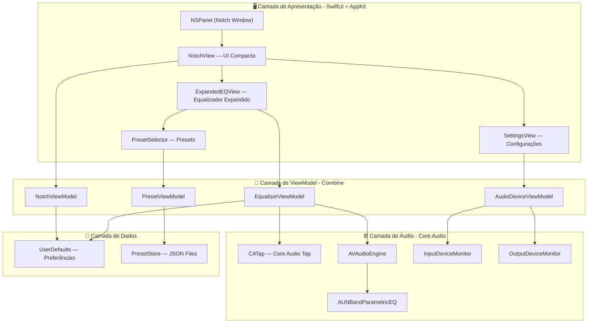
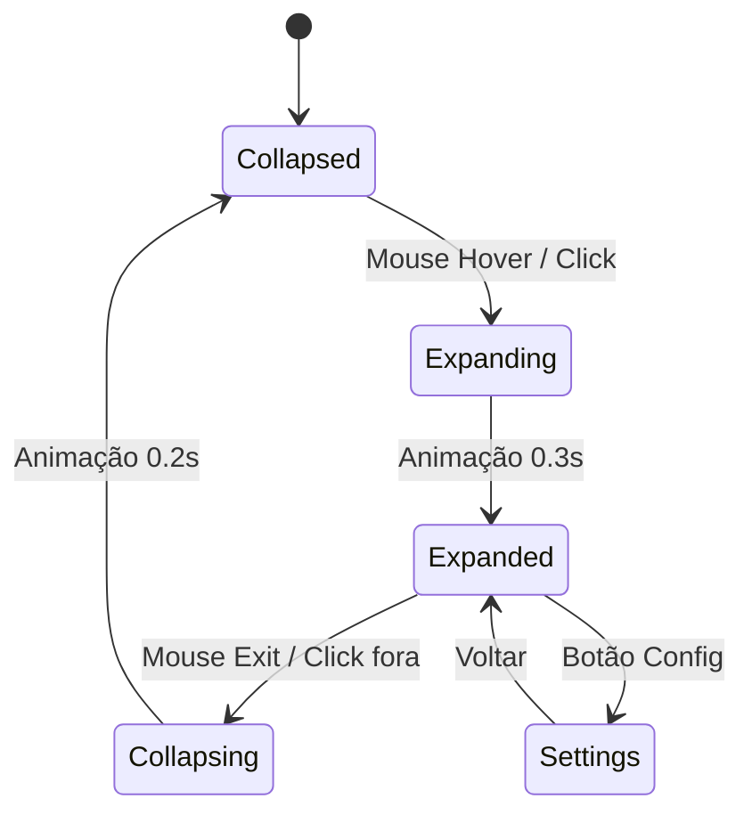
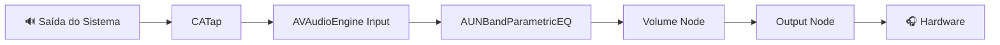
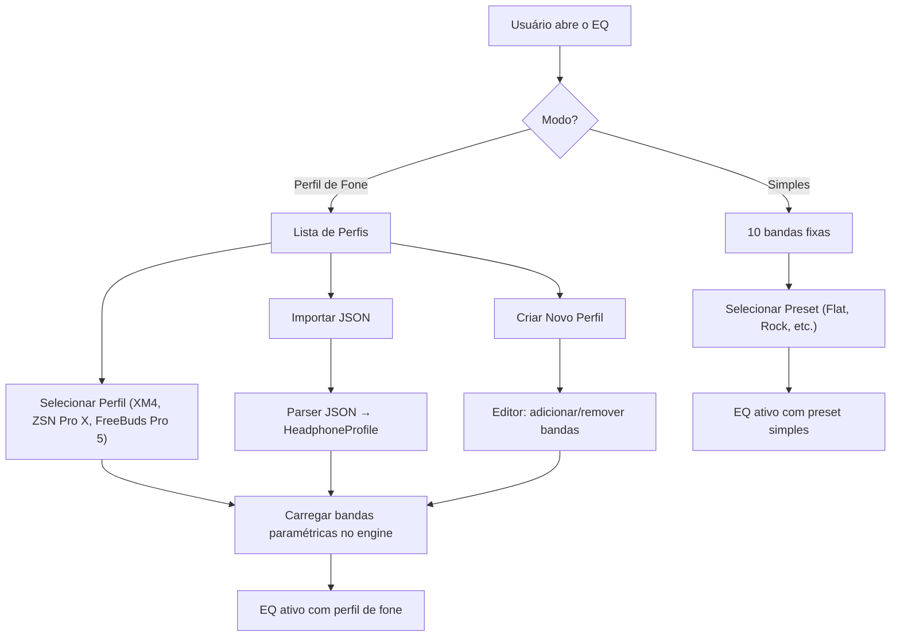

# 🎛️ Equalizer — Plano do Projeto

## Visão Geral

**Equalizer** é um aplicativo nativo para macOS que reside no **notch** do sistema operacional, oferecendo equalização de frequências em tempo real para entrada e saída de áudio do sistema. O app é projetado para ser **leve**, **não-intrusivo** e **visualmente elegante**, utilizando exclusivamente frameworks nativos da Apple.

> [!IMPORTANT]
> **Versão alvo:** macOS 15.7.7 Sequoia (Build 24G720)
> **Linguagem:** Swift 5.9+
> **Frameworks:** SwiftUI, AppKit, Core Audio, AVFAudio, AudioToolbox
> **Referência arquitetural:** [notchy-desktop-macos](file:///Users/josevansantos/Github/notchy-desktop-macos)

---

## Arquitetura do Sistema



---

## Estrutura de Diretórios do Projeto

```
Equalizer/
├── Equalizer.xcodeproj/
├── Equalizer/
│   ├── App/
│   │   ├── EqualizerApp.swift              # Entry point (@main)
│   │   ├── AppDelegate.swift               # NSApplicationDelegate
│   │   └── Info.plist                       # LSUIElement=true, entitlements
│   │
│   ├── Models/
│   │   ├── NotchState.swift                # Estados do notch (collapsed/expanded)
│   │   ├── EQBand.swift                    # Modelo de banda do EQ (freq, gain, Q, BW, filterType)
│   │   ├── EQFilterType.swift              # Enum: LOW_SHELF, PEAK, HIGH_SHELF, LOW_PASS, HIGH_PASS
│   │   ├── EQPreset.swift                  # Modelo de preset (genérico)
│   │   ├── HeadphoneProfile.swift          # Modelo de perfil de fone (paramétrico completo)
│   │   ├── AudioDeviceInfo.swift           # Info de dispositivo de áudio
│   │   └── AudioRoute.swift                # Enum: input/output
│   │
│   ├── ViewModels/
│   │   ├── NotchViewModel.swift            # Estado e animação do notch
│   │   ├── EqualizerViewModel.swift        # Estado do EQ, bands, bypass
│   │   ├── AudioDeviceViewModel.swift      # Seleção de dispositivos
│   │   ├── PresetViewModel.swift           # Gerenciamento de presets
│   │   └── HeadphoneProfileViewModel.swift # Gerenciamento de perfis de fone
│   │
│   ├── Views/
│   │   ├── Notch/
│   │   │   ├── NotchContainerView.swift    # Container principal do notch
│   │   │   ├── NotchCollapsedView.swift    # UI compacta (mini visualizer)
│   │   │   └── NotchExpandedView.swift     # UI expandida (EQ completo)
│   │   │
│   │   ├── Equalizer/
│   │   │   ├── EQBandSlider.swift          # Slider vertical por banda
│   │   │   ├── EQCurveView.swift           # Curva de frequência (Canvas)
│   │   │   ├── FrequencyLabels.swift       # Labels de frequência
│   │   │   └── GainIndicator.swift         # Indicador de ganho dB
│   │   │
│   │   ├── Controls/
│   │   │   ├── BypassToggle.swift          # Botão bypass on/off
│   │   │   ├── VolumeSlider.swift          # Controle de volume master
│   │   │   ├── PresetPicker.swift          # Seletor de presets
│   │   │   ├── ProfilePicker.swift         # Seletor de perfis de fone
│   │   │   └── IOSelector.swift            # Seletor Input/Output
│   │   │
│   │   ├── Profiles/
│   │   │   ├── ProfileListView.swift       # Lista de perfis de fone
│   │   │   ├── ProfileDetailView.swift     # Detalhe do perfil (tabela de bandas)
│   │   │   ├── ProfileEditorView.swift     # Editor de perfil paramétrico
│   │   │   ├── ProfileImportView.swift     # UI de importação de JSON
│   │   │   └── BandEditorRow.swift         # Row editável por banda
│   │   │
│   │   └── Settings/
│   │       ├── SettingsView.swift          # Tela de configurações
│   │       ├── AudioDeviceRow.swift        # Row de dispositivo
│   │       └── AboutView.swift             # Sobre o app
│   │
│   ├── Audio/
│   │   ├── AudioEngineManager.swift        # Gerenciador do AVAudioEngine
│   │   ├── CoreAudioTapManager.swift       # Interceptação via CATap
│   │   ├── EQProcessor.swift              # Processamento EQ (AudioUnit)
│   │   ├── ParametricEQProcessor.swift    # Processamento paramétrico (perfis de fone)
│   │   ├── AudioDeviceManager.swift        # Enumeração de dispositivos
│   │   ├── AudioLevelMeter.swift           # Medidor de nível (VU meter)
│   │   └── InputCaptureManager.swift       # Captura de áudio de entrada
│   │
│   ├── Helpers/
│   │   ├── NotchHelper.swift               # Criação e posicionamento do NSPanel
│   │   ├── ScreenHelper.swift              # Detecção de tela com notch
│   │   ├── AnimationHelper.swift           # Helpers de animação
│   │   ├── PermissionHelper.swift          # Solicitação de permissões
│   │   └── ProfileImporter.swift           # Parser de JSON/AutoEQ para perfis
│   │
│   ├── Extensions/
│   │   ├── NSScreen+Notch.swift            # Extension para notch geometry
│   │   ├── Color+Theme.swift              # Cores do tema
│   │   └── AudioUnit+EQ.swift             # Helpers para AudioUnit EQ
│   │
│   ├── Storage/
│   │   ├── PresetStore.swift              # Persistência de presets (JSON)
│   │   ├── ProfileStore.swift             # Persistência de perfis de fone (JSON)
│   │   ├── SettingsStore.swift            # Persistência de configurações
│   │   ├── Presets/                        # Presets padrão embutidos
│   │   │   ├── flat.json
│   │   │   ├── bass_boost.json
│   │   │   ├── vocal.json
│   │   │   ├── rock.json
│   │   │   ├── electronic.json
│   │   │   └── acoustic.json
│   │   │
│   │   └── HeadphoneProfiles/              # Perfis paramétricos de fones
│   │       ├── _schema.json               # JSON Schema de validação
│   │       ├── sony_wh1000xm4.json
│   │       ├── huawei_freebuds_pro5.json
│   │       ├── kz_zsn_pro_x.json
│   │       └── custom/                    # Perfis criados pelo usuário
│   │
│   ├── Resources/
│   │   └── Assets.xcassets/               # Ícones e assets
│   │
│   └── Equalizer.entitlements             # Entitlements necessários
│
└── EqualizerTests/
    ├── EQProcessorTests.swift
    ├── ParametricEQProcessorTests.swift
    ├── ProfileStoreTests.swift
    ├── ProfileImporterTests.swift
    ├── PresetStoreTests.swift
    └── EQBandModelTests.swift
```

---

## Fases do Projeto

---

### 📋 Fase 0 — Setup do Projeto & Configuração Base

**Objetivo:** Criar o projeto Xcode, configurar build settings e entitlements.

**Tarefas:**

| # | Tarefa | Detalhe |
|---|--------|---------|
| 0.1 | Criar projeto Xcode | macOS App, SwiftUI lifecycle, Swift, deployment target 15.0 |
| 0.2 | Configurar `Info.plist` | `LSUIElement = true` (sem ícone no Dock) |
| 0.3 | Configurar Entitlements | `com.apple.security.audio-recording` para captura de áudio |
| 0.4 | Configurar Signing | Desenvolvimento local com Developer ID, sandbox desabilitada¹ |
| 0.5 | Criar estrutura de diretórios | Conforme a árvore definida acima |
| 0.6 | Configurar `.gitignore` | Ignorar `.build/`, `DerivedData/`, `xcuserdata/` |

> [!NOTE]
> ¹ A sandbox precisa ser desabilitada para acesso ao Core Audio Tap (interceptação de áudio do sistema). Alternativamente, pode-se usar entitlements específicos para o `com.apple.security.temporary-exception.audio-unit-host`.

**Entregável:** Projeto Xcode compilando e executando (janela vazia, sem Dock icon).

---

### 📋 Fase 1 — Notch Window & Interface Base

**Objetivo:** Criar a janela flutuante posicionada no notch, com estados collapsed/expanded.

**Referência direta:** [notchy-desktop-macos](file:///Users/josevansantos/Github/notchy-desktop-macos)

#### 1.1 — NSPanel & Posicionamento

```swift
// NotchHelper.swift — Conceito base
class NotchHelper {
    static func createNotchPanel() -> NSPanel {
        let panel = NSPanel(
            contentRect: .zero,
            styleMask: [.borderless, .nonactivatingPanel, .fullSizeContentView],
            backing: .buffered,
            defer: false
        )
        panel.isFloatingPanel = true
        panel.level = .statusBar
        panel.backgroundColor = .clear
        panel.hasShadow = false
        panel.isOpaque = false
        panel.collectionBehavior = [.canJoinAllSpaces, .stationary, .fullScreenAuxiliary]
        panel.isMovableByWindowBackground = false
        panel.hidesOnDeactivate = false
        return panel
    }
}
```

#### 1.2 — Detecção do Notch

```swift
// NSScreen+Notch.swift
extension NSScreen {
    var hasNotch: Bool {
        guard let topSafeInset = safeAreaInsets?.top else { return false }
        return topSafeInset > 0
    }
    
    var notchSize: CGSize {
        // Notch padrão MacBook: ~200x32 pontos
        return CGSize(width: 200, height: 32)
    }
    
    var notchFrame: NSRect {
        let screenFrame = self.frame
        let notch = notchSize
        return NSRect(
            x: screenFrame.midX - notch.width / 2,
            y: screenFrame.maxY - notch.height,
            width: notch.width,
            height: notch.height
        )
    }
}
```

#### 1.3 — Estados do Notch



| Estado | Dimensões (aprox.) | Conteúdo |
|--------|-------------------|----------|
| `collapsed` | 200×32 pts | Mini visualizer + ícone EQ |
| `expanded` | 400×320 pts | EQ completo + controles |
| `settings` | 400×280 pts | Configurações + dispositivos |

#### 1.4 — UI Collapsed (Mini Visualizer)

- Exibir mini barras de frequência (8 barras animadas)
- Ícone do EQ sutil (indicando ativo/bypass)
- Hover effect suave com `NSTrackingArea`

#### 1.5 — Animação de Transição

```swift
// NotchViewModel.swift
@Published var notchState: NotchState = .collapsed
@Published var notchSize: CGSize = CGSize(width: 200, height: 32)

func expand() {
    withAnimation(.spring(response: 0.35, dampingFraction: 0.8)) {
        notchState = .expanded
        notchSize = CGSize(width: 400, height: 320)
    }
}

func collapse() {
    withAnimation(.easeOut(duration: 0.2)) {
        notchState = .collapsed
        notchSize = CGSize(width: 200, height: 32)
    }
}
```

**Entregável:** Janela no notch com transição animada collapsed ↔ expanded.

---

### 📋 Fase 2 — Interface do Equalizador

**Objetivo:** Construir a interface visual completa do equalizador.

#### 2.1 — EQ Filter Types

```swift
// EQFilterType.swift
enum EQFilterType: String, Codable, CaseIterable {
    case lowShelf   = "LOW_SHELF"
    case peak       = "PEAK"
    case highShelf  = "HIGH_SHELF"
    case lowPass    = "LOW_PASS"
    case highPass   = "HIGH_PASS"
    case bandPass   = "BAND_PASS"
    case notch      = "NOTCH"
    
    /// Mapeamento para AVAudioUnitEQFilterType nativo
    var audioUnitFilterType: AVAudioUnitEQFilterType {
        switch self {
        case .lowShelf:  return .lowShelf
        case .peak:      return .parametric
        case .highShelf: return .highShelf
        case .lowPass:   return .lowPass
        case .highPass:  return .highPass
        case .bandPass:  return .bandPass
        case .notch:     return .parametric // Notch simulado via Q alto
        }
    }
    
    var displayName: String {
        switch self {
        case .lowShelf:  return "Low Shelf"
        case .peak:      return "Peak"
        case .highShelf: return "High Shelf"
        case .lowPass:   return "Low Pass"
        case .highPass:  return "High Pass"
        case .bandPass:  return "Band Pass"
        case .notch:     return "Notch"
        }
    }
}
```

#### 2.2 — EQ Band Model (Paramétrico Completo)

```swift
// EQBand.swift
struct EQBand: Identifiable, Codable {
    let id: UUID
    var filterType: EQFilterType  // LOW_SHELF, PEAK, HIGH_SHELF, etc.
    var frequency: Float          // Hz (qualquer valor: 30, 66, 110, 930, etc.)
    var gain: Float               // dB (-30.0 a +30.0 para suportar perfis extremos)
    var qFactor: Float            // Q-Factor (0.1 a 20.0)
    var bandwidth: Float          // BW em oitavas (calculado a partir do Q)
    var isEnabled: Bool
    
    /// Calcula BW a partir do Q-Factor: BW = 1/Q * sqrt(2)
    /// Fórmula precisa: BW = (2 / ln(2)) * arcsinh(1 / (2*Q))
    static func bandwidthFromQ(_ q: Float) -> Float {
        return (2.0 / log(2.0)) * asinh(1.0 / (2.0 * q))
    }
    
    /// Calcula Q-Factor a partir do BW
    static func qFromBandwidth(_ bw: Float) -> Float {
        return 1.0 / (2.0 * sinh(log(2.0) / 2.0 * bw))
    }
    
    var frequencyLabel: String {
        if frequency >= 1000 {
            let kHz = frequency / 1000
            return kHz.truncatingRemainder(dividingBy: 1) == 0
                ? "\(Int(kHz))k"
                : String(format: "%.1fk", kHz)
        }
        return "\(Int(frequency))"
    }
}
```

> [!IMPORTANT]
> O modelo `EQBand` suporta **qualquer frequência** (não apenas as 10 bandas fixas), **qualquer tipo de filtro**, e parâmetros completos de **Q-Factor** e **Bandwidth**. Isso permite carregar perfis paramétricos avançados de fones de ouvido diretamente de JSONs.

#### 2.3 — Bandas de Frequência (Configuração Padrão — 10 bandas)

A configuração padrão usa 10 bandas fixas para o modo de equalização simples:

| Banda | Frequência | Tipo de Filtro | Q-Factor | BW |
|-------|-----------|----------------|----------|----|
| 1 | 32 Hz | LOW_SHELF | 0.71 | 1.89 |
| 2 | 64 Hz | PEAK | 1.0 | 1.39 |
| 3 | 125 Hz | PEAK | 1.0 | 1.39 |
| 4 | 250 Hz | PEAK | 1.0 | 1.39 |
| 5 | 500 Hz | PEAK | 1.0 | 1.39 |
| 6 | 1 kHz | PEAK | 1.0 | 1.39 |
| 7 | 2 kHz | PEAK | 1.0 | 1.39 |
| 8 | 4 kHz | PEAK | 1.0 | 1.39 |
| 9 | 8 kHz | PEAK | 1.0 | 1.39 |
| 10 | 16 kHz | HIGH_SHELF | 0.71 | 1.89 |

#### 2.4 — Exemplo: Perfil Paramétrico de Fone (Modo Avançado)

Quando um **Headphone Profile** é carregado, as bandas são substituídas pelos valores do perfil:

| Banda | Tipo | Frequência | Gain | Q-Factor | BW |
|-------|------|-----------|------|----------|----|
| 1 | LOW_SHELF | 30 Hz | -5.5 dB | 0.71 | 1.89 |
| 2 | PEAK | 66 Hz | -9.8 dB | 0.40 | 3.02 |
| 3 | LOW_SHELF | 110 Hz | +10.0 dB | 0.71 | 1.89 |
| 4 | PEAK | 930 Hz | +3.3 dB | 1.00 | 1.39 |
| 5 | PEAK | 1350 Hz | -1.5 dB | 1.60 | 0.89 |
| 6 | PEAK | 2340 Hz | -4.3 dB | 1.80 | 0.79 |
| 7 | PEAK | 3430 Hz | +5.0 dB | 1.40 | 1.01 |
| 8 | PEAK | 4900 Hz | -4.0 dB | 3.50 | 0.41 |
| 9 | HIGH_SHELF | 8000 Hz | -6.0 dB | 0.71 | 1.89 |
| 10 | — | — | — | — | — |

#### 2.3 — Componentes Visuais

**EQ Band Slider (Vertical):**
- Slider vertical customizado para cada banda
- Range: -12dB a +12dB (modo simples) / -30dB a +30dB (modo perfil de fone)
- Snap to 0dB com haptic feedback (se trackpad suportar)
- Label de frequência embaixo + tipo de filtro (ícone)
- Valor em dB acima
- Indicador visual do Q-Factor (largura da "curva" no slider)

**EQ Curve View (Canvas 2D):**
- Curva suave (Bézier) conectando os pontos de ganho
- Gradiente sob a curva (verde → amarelo → vermelho)
- Grid de referência (linhas horizontais a cada 3dB)
- Atualização em tempo real (60fps via `CADisplayLink`)

**Layout do Expanded View:**

```
┌─────────────────────────────────────────┐
│  ┌──────────────────────────────────┐   │
│  │        EQ Curve View             │   │
│  │    ~~~~~/\~~~~~/\~~~~~~          │   │
│  └──────────────────────────────────┘   │
│                                         │
│  │ │ │ │ │ │ │ │ │ │   ← Sliders       │
│  │ │ │ │ │ │ │ │ │ │                    │
│  │ │ │ │ │ │ │ │ │ │                    │
│  32 64 125 250 500 1k 2k 4k 8k 16k     │
│                                         │
│  [🔊 Vol] [Preset ▾] [🎧 Profile] [⏻] [⚙️] │
└───────────────────────────────────────────────┘
```

#### 2.4 — Controles

| Controle | Tipo | Função |
|----------|------|--------|
| Volume Master | Slider horizontal | Volume geral (-40dB a +6dB) |
| Preset Picker | Dropdown menu | Seleção de preset (EQ simples) |
| Profile Picker | Dropdown menu | Seleção de perfil de fone (🎧) |
| Bypass Toggle | Toggle button | Ativar/desativar EQ |
| IO Selector | Segmented control | Alternar entre Input/Output |
| Mode Selector | Segmented control | Alternar: Simples (10 bandas) / Perfil (paramétrico) |
| Settings | Icon button | Abrir configurações |
| Reset | Button (long press) | Reset todas as bandas para 0dB |

#### 2.5 — Tema Visual

```swift
// Color+Theme.swift
extension Color {
    static let eqBackground = Color(nsColor: NSColor(white: 0.08, alpha: 0.95))
    static let eqSurface = Color(nsColor: NSColor(white: 0.12, alpha: 1.0))
    static let eqAccent = Color(hue: 0.55, saturation: 0.8, brightness: 0.9)     // Ciano
    static let eqPositive = Color(hue: 0.35, saturation: 0.7, brightness: 0.8)   // Verde
    static let eqNegative = Color(hue: 0.0, saturation: 0.7, brightness: 0.8)    // Vermelho
    static let eqNeutral = Color(nsColor: NSColor(white: 0.5, alpha: 1.0))       // Cinza
    static let eqGrid = Color(nsColor: NSColor(white: 0.2, alpha: 0.5))
}
```

- **Fundo:** Dark glass effect (`NSVisualEffectView` com material `.hudWindow`)
- **Bordas:** Rounded corners (16pt) com border sutil (1pt, branco 10%)
- **Tipografia:** SF Pro (sistema), pesos regular/medium/semibold
- **Animações:** Spring animations para sliders, ease-out para transições

**Entregável:** Interface completa do EQ no notch com todos os controles visuais funcionais (sem processamento de áudio ainda).

---

### 📋 Fase 3 — Motor de Áudio (Output)

**Objetivo:** Implementar interceptação e processamento de áudio de saída do sistema.

#### 3.1 — Core Audio Tap (Captura de Saída)

> [!IMPORTANT]
> O **Core Audio Tap (CATap)** é a API nativa da Apple introduzida no macOS 14.2+ para interceptar áudio do sistema sem necessidade de drivers virtuais. Como o target é macOS 15.7.7, essa API está disponível.

```swift
// CoreAudioTapManager.swift — Fluxo conceitual
class CoreAudioTapManager {
    private var tapID: AudioObjectID = kAudioObjectUnknown
    private var aggregateDeviceID: AudioObjectID = kAudioObjectUnknown
    
    /// 1. Criar o Process Tap para capturar áudio de saída
    func createSystemOutputTap() throws {
        var tapDescription = CATapDescription(
            stereoMixdownOfProcesses: [] // vazio = captura toda saída
        )
        tapDescription.uuid = UUID()
        tapDescription.name = "Equalizer System Tap" as CFString
        
        // Registrar o tap no sistema
        var tapID: AudioObjectID = kAudioObjectUnknown
        let status = CATapCreate(kAudioObjectSystemObject, &tapDescription, &tapID)
        guard status == noErr else { throw AudioError.tapCreationFailed(status) }
        self.tapID = tapID
    }
    
    /// 2. Criar Aggregate Device com o Tap
    func createAggregateDevice() throws {
        // O aggregate device combina o tap com o output device real
        // permitindo processar o áudio antes de chegar ao hardware
    }
    
    /// 3. Iniciar captura
    func startCapture(processingBlock: @escaping (AVAudioPCMBuffer) -> Void) {
        // Conectar ao AVAudioEngine para processamento
    }
}
```

#### 3.2 — Pipeline de Processamento



#### 3.3 — EQ Processor (AudioUnit)

```swift
// EQProcessor.swift
class EQProcessor {
    private var audioEngine: AVAudioEngine
    private var eqNode: AVAudioUnitEQ
    
    init(bandCount: Int = 10) {
        audioEngine = AVAudioEngine()
        eqNode = AVAudioUnitEQ(numberOfBands: bandCount)
        
        configureBands()
        connectNodes()
    }
    
    private func configureBands() {
        let frequencies: [Float] = [32, 64, 125, 250, 500, 1000, 2000, 4000, 8000, 16000]
        
        for (index, band) in eqNode.bands.enumerated() {
            band.frequency = frequencies[index]
            band.gain = 0.0  // Flat por padrão
            band.bandwidth = 1.0
            band.bypass = false
            
            // Primeiro e último são shelf filters
            if index == 0 {
                band.filterType = .lowShelf
            } else if index == frequencies.count - 1 {
                band.filterType = .highShelf
            } else {
                band.filterType = .parametric
            }
        }
    }
    
    /// Atualizar ganho de uma banda (chamado pela UI)
    func updateBand(index: Int, gain: Float) {
        guard index < eqNode.bands.count else { return }
        eqNode.bands[index].gain = gain
    }
    
    /// Bypass geral
    func setBypass(_ bypass: Bool) {
        eqNode.bypass = bypass
    }
}
```

#### 3.4 — Gerenciamento do Engine

```swift
// AudioEngineManager.swift
class AudioEngineManager: ObservableObject {
    @Published var isRunning = false
    @Published var isBypassed = false
    @Published var outputLevel: Float = 0.0
    
    private let tapManager = CoreAudioTapManager()
    private let eqProcessor: EQProcessor
    private let levelMeter = AudioLevelMeter()
    
    func start() throws {
        try tapManager.createSystemOutputTap()
        try tapManager.createAggregateDevice()
        
        // Conectar tap → engine → eq → output
        tapManager.startCapture { [weak self] buffer in
            self?.eqProcessor.process(buffer)
            self?.levelMeter.analyze(buffer)
        }
        
        isRunning = true
    }
    
    func stop() {
        tapManager.destroyTap()
        eqProcessor.stop()
        isRunning = false
    }
}
```

**Entregável:** Áudio de saída do sistema sendo processado pelo EQ em tempo real. Sliders alterando as bandas com efeito audível.

---

### 📋 Fase 4 — Motor de Áudio (Input)

**Objetivo:** Adicionar equalização para áudio de entrada (microfone).

#### 4.1 — Captura de Input

```swift
// InputCaptureManager.swift
class InputCaptureManager {
    private var audioEngine = AVAudioEngine()
    private var eqNode: AVAudioUnitEQ
    
    func startInputProcessing(deviceID: AudioDeviceID) throws {
        let inputNode = audioEngine.inputNode
        let format = inputNode.outputFormat(forBus: 0)
        
        // Conectar: input → EQ → output (virtual ou real)
        audioEngine.attach(eqNode)
        audioEngine.connect(inputNode, to: eqNode, format: format)
        audioEngine.connect(eqNode, to: audioEngine.mainMixerNode, format: format)
        
        try audioEngine.start()
    }
}
```

#### 4.2 — Seletor Input/Output na UI

```swift
// IOSelector.swift
struct IOSelector: View {
    @Binding var selectedRoute: AudioRoute
    
    var body: some View {
        Picker("", selection: $selectedRoute) {
            Text("Output").tag(AudioRoute.output)
            Text("Input").tag(AudioRoute.input)
        }
        .pickerStyle(.segmented)
        .frame(width: 140)
    }
}
```

#### 4.3 — Gerenciamento de Dispositivos

```swift
// AudioDeviceManager.swift
class AudioDeviceManager: ObservableObject {
    @Published var inputDevices: [AudioDeviceInfo] = []
    @Published var outputDevices: [AudioDeviceInfo] = []
    @Published var selectedInputDevice: AudioDeviceInfo?
    @Published var selectedOutputDevice: AudioDeviceInfo?
    
    func enumerateDevices() {
        // Usar AudioObjectGetPropertyData com 
        // kAudioHardwarePropertyDevices para listar dispositivos
    }
    
    func listenForDeviceChanges() {
        // Registrar listener com AudioObjectAddPropertyListener
        // para detectar conexão/desconexão de dispositivos
    }
}
```

> [!NOTE]
> O EQ de Input é mais simples que o de Output: não requer Core Audio Tap. O `AVAudioEngine.inputNode` já dá acesso direto ao microfone com as devidas permissões.

**Entregável:** EQ funcional para input e output, com toggle de alternância na UI.

---

### 📋 Fase 5 — Sistema de Presets & Perfis de Fones (Headphone Profiles)

**Objetivo:** Implementar dois sistemas complementares: (1) **Presets simples** para EQ de 10 bandas e (2) **Perfis paramétricos de fones** com filtros avançados, Q-Factor e Bandwidth, armazenados em JSON.

> [!IMPORTANT]
> O sistema de **Headphone Profiles** é o diferencial do app. Permite importar perfis de equalização paramétrica específicos para cada modelo de fone, com suporte completo a tipos de filtro (LOW_SHELF, PEAK, HIGH_SHELF), frequências livres, Q-Factor e Bandwidth — tudo via arquivos JSON.

---

#### 5.1 — Presets Simples (10 bandas fixas)

Presets rápidos para uso sem fone específico:

| Preset | 32Hz | 64Hz | 125Hz | 250Hz | 500Hz | 1kHz | 2kHz | 4kHz | 8kHz | 16kHz |
|--------|------|------|-------|-------|-------|------|------|------|------|-------|
| Flat | 0 | 0 | 0 | 0 | 0 | 0 | 0 | 0 | 0 | 0 |
| Bass Boost | +6 | +5 | +3 | +1 | 0 | 0 | 0 | 0 | 0 | 0 |
| Vocal | -2 | -1 | 0 | +2 | +4 | +4 | +3 | +1 | 0 | -1 |
| Rock | +4 | +3 | +1 | 0 | -1 | +1 | +3 | +4 | +3 | +2 |
| Electronic | +5 | +4 | +2 | 0 | -2 | 0 | +2 | +4 | +5 | +4 |
| Acoustic | +2 | +2 | +1 | +1 | +2 | +2 | +1 | +3 | +3 | +2 |

---

#### 5.2 — Headphone Profiles (Perfis Paramétricos de Fones)

##### 5.2.1 — Modelo de Dados

```swift
// HeadphoneProfile.swift
struct HeadphoneProfile: Identifiable, Codable {
    let id: UUID
    var name: String                    // Ex: "Sennheiser HD 600"
    var brand: String                   // Ex: "Sennheiser"
    var model: String                   // Ex: "HD 600"
    var description: String             // Descrição do perfil
    var targetCurve: String             // Ex: "Harman 2019", "Diffuse Field", "Custom"
    var preampGain: Float               // Ganho de pré-amplificação (dB)
    var bands: [ProfileBand]            // Bandas paraméricas (N bandas, sem limite fixo)
    var isBuiltIn: Bool                 // Perfil embutido ou do usuário
    var source: String?                 // Ex: "AutoEQ", "oratory1990", "Custom"
    var createdAt: Date
    var updatedAt: Date
    
    struct ProfileBand: Identifiable, Codable {
        let id: UUID
        var filterType: EQFilterType    // LOW_SHELF, PEAK, HIGH_SHELF
        var frequency: Float            // Hz (qualquer valor)
        var gain: Float                 // dB
        var qFactor: Float              // Q-Factor
        var bandwidth: Float            // BW em oitavas
        var isEnabled: Bool             // Permite desativar bandas individuais
    }
}
```

##### 5.2.2 — JSON Schema do Headphone Profile

```json
{
  "$schema": "https://json-schema.org/draft/2020-12/schema",
  "title": "Equalizer Headphone Profile",
  "type": "object",
  "required": ["name", "brand", "model", "bands"],
  "properties": {
    "id": { "type": "string", "format": "uuid" },
    "name": { "type": "string" },
    "brand": { "type": "string" },
    "model": { "type": "string" },
    "description": { "type": "string" },
    "targetCurve": { "type": "string", "default": "Harman 2019" },
    "preampGain": { "type": "number", "default": 0.0 },
    "source": { "type": "string" },
    "bands": {
      "type": "array",
      "minItems": 1,
      "maxItems": 20,
      "items": {
        "type": "object",
        "required": ["filterType", "frequency", "gain", "qFactor"],
        "properties": {
          "filterType": { "enum": ["LOW_SHELF", "PEAK", "HIGH_SHELF", "LOW_PASS", "HIGH_PASS"] },
          "frequency": { "type": "number", "minimum": 20, "maximum": 20000 },
          "gain": { "type": "number", "minimum": -30, "maximum": 30 },
          "qFactor": { "type": "number", "minimum": 0.1, "maximum": 20.0 },
          "bandwidth": { "type": "number", "minimum": 0.01, "maximum": 10.0 },
          "enabled": { "type": "boolean", "default": true }
        }
      }
    }
  }
}
```

##### 5.2.3 — Exemplo: Arquivo JSON de um Perfil de Fone

```json
{
  "id": "a1b2c3d4-e5f6-7890-abcd-ef1234567890",
  "name": "Sony WH-1000XM4 — Harman Target (ANC ON)",
  "brand": "Sony",
  "model": "WH-1000XM4",
  "description": "Perfil de equalização paramétrica para o Sony WH-1000XM4 com ANC ativado, baseado na curva-alvo Harman 2019. Corrige o excesso de graves e traz clareza aos médios.",
  "targetCurve": "Harman 2019",
  "preampGain": -5.6,
  "source": "oratory1990",
  "bands": [
    {
      "filterType": "LOW_SHELF",
      "frequency": 105,
      "gain": 5.5,
      "qFactor": 0.71,
      "bandwidth": 1.89,
      "enabled": true
    },
    {
      "filterType": "LOW_SHELF",
      "frequency": 210,
      "gain": -9.5,
      "qFactor": 0.71,
      "bandwidth": 1.89,
      "enabled": true
    },
    {
      "filterType": "PEAK",
      "frequency": 580,
      "gain": -1.5,
      "qFactor": 2.5,
      "bandwidth": 0.57,
      "enabled": true
    },
    {
      "filterType": "PEAK",
      "frequency": 1430,
      "gain": -2.5,
      "qFactor": 3.0,
      "bandwidth": 0.48,
      "enabled": true
    },
    {
      "filterType": "PEAK",
      "frequency": 2300,
      "gain": 6.0,
      "qFactor": 1.2,
      "bandwidth": 1.17,
      "enabled": true
    },
    {
      "filterType": "PEAK",
      "frequency": 3930,
      "gain": -2.4,
      "qFactor": 4.0,
      "bandwidth": 0.36,
      "enabled": true
    },
    {
      "filterType": "PEAK",
      "frequency": 5200,
      "gain": -4.2,
      "qFactor": 4.0,
      "bandwidth": 0.36,
      "enabled": true
    },
    {
      "filterType": "PEAK",
      "frequency": 7400,
      "gain": 3.0,
      "qFactor": 2.0,
      "bandwidth": 0.71,
      "enabled": true
    },
    {
      "filterType": "PEAK",
      "frequency": 8100,
      "gain": -5.0,
      "qFactor": 4.0,
      "bandwidth": 0.36,
      "enabled": true
    },
    {
      "filterType": "PEAK",
      "frequency": 11600,
      "gain": -3.0,
      "qFactor": 6.0,
      "bandwidth": 0.24,
      "enabled": true
    }
  ]
}
```

##### 5.2.4 — Exemplo: `kz_zsn_pro_x.json`

```json
{
  "id": "b2c3d4e5-f6a7-8901-bcde-f12345678901",
  "name": "KZ ZSN Pro X — Harman IE Target",
  "brand": "KZ",
  "model": "ZSN Pro X",
  "description": "Perfil de equalização para o KZ ZSN Pro X. Corrige a assinatura em V, domando os agudos agressivos e equilibrando os graves.",
  "targetCurve": "Harman IE 2019",
  "preampGain": -4.2,
  "source": "AutoEQ",
  "bands": [
    {
      "filterType": "LOW_SHELF",
      "frequency": 105,
      "gain": 0.5,
      "qFactor": 0.70,
      "bandwidth": 1.92,
      "enabled": true
    },
    {
      "filterType": "PEAK",
      "frequency": 159,
      "gain": -3.5,
      "qFactor": 0.70,
      "bandwidth": 1.92,
      "enabled": true
    },
    {
      "filterType": "PEAK",
      "frequency": 828,
      "gain": 4.2,
      "qFactor": 0.92,
      "bandwidth": 1.52,
      "enabled": true
    },
    {
      "filterType": "PEAK",
      "frequency": 2251,
      "gain": -2.9,
      "qFactor": 1.09,
      "bandwidth": 1.29,
      "enabled": true
    },
    {
      "filterType": "PEAK",
      "frequency": 4200,
      "gain": -3.5,
      "qFactor": 2.5,
      "bandwidth": 0.57,
      "enabled": true
    },
    {
      "filterType": "PEAK",
      "frequency": 6500,
      "gain": -5.0,
      "qFactor": 3.0,
      "bandwidth": 0.48,
      "enabled": true
    },
    {
      "filterType": "PEAK",
      "frequency": 8200,
      "gain": -2.5,
      "qFactor": 4.0,
      "bandwidth": 0.36,
      "enabled": true
    },
    {
      "filterType": "HIGH_SHELF",
      "frequency": 10000,
      "gain": -2.0,
      "qFactor": 0.70,
      "bandwidth": 1.92,
      "enabled": true
    }
  ]
}
```

##### 5.2.5 — Exemplo: `huawei_freebuds_pro5.json`

```json
{
  "id": "c3d4e5f6-a7b8-9012-cdef-123456789012",
  "name": "Huawei FreeBuds Pro 5 — Balanced Target",
  "brand": "Huawei",
  "model": "FreeBuds Pro 5",
  "description": "Perfil de equalização para o Huawei FreeBuds Pro 5. Melhora a separação de instrumentos e controla os graves levemente acentuados de fábrica.",
  "targetCurve": "Harman IE 2019",
  "preampGain": -3.5,
  "source": "Custom",
  "bands": [
    {
      "filterType": "LOW_SHELF",
      "frequency": 80,
      "gain": -2.5,
      "qFactor": 0.71,
      "bandwidth": 1.89,
      "enabled": true
    },
    {
      "filterType": "PEAK",
      "frequency": 160,
      "gain": -1.8,
      "qFactor": 1.0,
      "bandwidth": 1.39,
      "enabled": true
    },
    {
      "filterType": "PEAK",
      "frequency": 620,
      "gain": 1.5,
      "qFactor": 1.2,
      "bandwidth": 1.17,
      "enabled": true
    },
    {
      "filterType": "PEAK",
      "frequency": 1800,
      "gain": -1.0,
      "qFactor": 2.0,
      "bandwidth": 0.71,
      "enabled": true
    },
    {
      "filterType": "PEAK",
      "frequency": 3500,
      "gain": 2.0,
      "qFactor": 1.5,
      "bandwidth": 0.95,
      "enabled": true
    },
    {
      "filterType": "PEAK",
      "frequency": 5500,
      "gain": -2.8,
      "qFactor": 3.0,
      "bandwidth": 0.48,
      "enabled": true
    },
    {
      "filterType": "PEAK",
      "frequency": 7800,
      "gain": 1.5,
      "qFactor": 2.5,
      "bandwidth": 0.57,
      "enabled": true
    },
    {
      "filterType": "HIGH_SHELF",
      "frequency": 10000,
      "gain": -1.5,
      "qFactor": 0.71,
      "bandwidth": 1.89,
      "enabled": true
    }
  ]
}
```

##### 5.2.6 — Perfis Built-in

O app inclui perfis pré-configurados para os fones do usuário:

| Fone | Marca | Curva-Alvo | Bandas | Preamp | Fonte |
|------|-------|-----------|--------|--------|-------|
| **WH-1000XM4** | Sony | Harman 2019 | 10 | -5.6 dB | oratory1990 |
| **FreeBuds Pro 5** | Huawei | Harman IE 2019 | 8 | -3.5 dB | Custom |
| **ZSN Pro X** | KZ | Harman IE 2019 | 8 | -4.2 dB | AutoEQ |

> [!NOTE]
> O perfil do **Huawei FreeBuds Pro 5** foi criado como "Custom" pois este fone ainda não possui medições laboratoriais publicadas no AutoEQ/oratory1990. O perfil incluso é uma aproximação baseada na resposta de frequência reportada pela comunidade, e pode ser refinado pelo usuário através do editor de perfis.
>
> Novos perfis podem ser adicionados a qualquer momento importando arquivos JSON ou criando do zero no editor.

---

#### 5.3 — Processador Paramétrico para Perfis

```swift
// ParametricEQProcessor.swift
class ParametricEQProcessor {
    private var eqNode: AVAudioUnitEQ
    
    /// Carrega um perfil de fone no engine de áudio
    /// O número de bandas é dinâmico (1-20)
    func loadProfile(_ profile: HeadphoneProfile) {
        // Recria o AVAudioUnitEQ com o número correto de bandas
        let bandCount = profile.bands.filter { $0.isEnabled }.count
        eqNode = AVAudioUnitEQ(numberOfBands: bandCount)
        
        // Aplicar pré-amplificação
        eqNode.globalGain = profile.preampGain
        
        // Configurar cada banda
        for (index, profileBand) in profile.bands.filter({ $0.isEnabled }).enumerated() {
            let band = eqNode.bands[index]
            band.filterType = profileBand.filterType.audioUnitFilterType
            band.frequency = profileBand.frequency
            band.gain = profileBand.gain
            band.bandwidth = profileBand.bandwidth
            band.bypass = false
        }
    }
    
    /// Alterna entre modo simples (10 bandas) e modo perfil
    func switchToSimpleMode() {
        eqNode = AVAudioUnitEQ(numberOfBands: 10)
        // Restaurar bandas fixas padrão
    }
}
```

---

#### 5.4 — Importação & Exportação de Perfis

```swift
// ProfileImporter.swift
class ProfileImporter {
    
    /// Importar perfil de arquivo JSON local
    func importFromJSON(url: URL) throws -> HeadphoneProfile {
        let data = try Data(contentsOf: url)
        let decoder = JSONDecoder()
        decoder.dateDecodingStrategy = .iso8601
        return try decoder.decode(HeadphoneProfile.self, from: data)
    }
    
    /// Exportar perfil para JSON
    func exportToJSON(profile: HeadphoneProfile, to url: URL) throws {
        let encoder = JSONEncoder()
        encoder.outputFormatting = [.prettyPrinted, .sortedKeys]
        encoder.dateEncodingStrategy = .iso8601
        let data = try encoder.encode(profile)
        try data.write(to: url)
    }
    
    /// Importar de formato AutoEQ (ParametricEQ.txt)
    /// Converte o formato texto do AutoEQ para o JSON do Equalizer
    func importFromAutoEQ(text: String) throws -> HeadphoneProfile {
        // Parser para o formato:
        // "Filter 1: ON PK Fc 66 Hz Gain -9.8 dB Q 0.40"
        // "Filter 2: ON LSC Fc 30 Hz Gain -5.5 dB Q 0.71"
        var bands: [HeadphoneProfile.ProfileBand] = []
        
        let lines = text.components(separatedBy: .newlines)
        for line in lines {
            guard line.hasPrefix("Filter") else { continue }
            // Parse filter type, frequency, gain, Q
            // PK → .peak, LSC → .lowShelf, HSC → .highShelf
            let band = try parseAutoEQLine(line)
            bands.append(band)
        }
        
        return HeadphoneProfile(
            id: UUID(),
            name: "Imported AutoEQ Profile",
            brand: "",
            model: "",
            description: "Importado do formato AutoEQ ParametricEQ",
            targetCurve: "Unknown",
            preampGain: parsePreampGain(from: text),
            bands: bands,
            isBuiltIn: false,
            source: "AutoEQ",
            createdAt: Date(),
            updatedAt: Date()
        )
    }
}
```

> [!TIP]
> **Compatibilidade com AutoEQ:** O formato do [AutoEQ](https://github.com/jaakkopasanen/AutoEq) (`ParametricEQ.txt`) é amplamente utilizado pela comunidade audiófila. O importador converte automaticamente os tipos de filtro: `PK` → `PEAK`, `LSC` → `LOW_SHELF`, `HSC` → `HIGH_SHELF`.

---

#### 5.5 — Modelo de Preset Simples

```swift
// EQPreset.swift
struct EQPreset: Identifiable, Codable {
    let id: UUID
    var name: String
    var bands: [EQBandValue]
    var isBuiltIn: Bool
    var createdAt: Date
    
    struct EQBandValue: Codable {
        var frequency: Float
        var gain: Float
        var qFactor: Float
        var bandwidth: Float
        var filterType: EQFilterType
    }
}
```

#### 5.6 — Persistência

```swift
// ProfileStore.swift
class ProfileStore: ObservableObject {
    @Published var profiles: [HeadphoneProfile] = []
    @Published var activeProfile: HeadphoneProfile?
    
    /// ~/Library/Application Support/Equalizer/HeadphoneProfiles/
    private let userProfilesURL: URL
    
    func loadBuiltInProfiles() { /* Carregar do bundle */ }
    func loadUserProfiles() { /* Carregar do diretório do usuário */ }
    func saveProfile(_ profile: HeadphoneProfile) throws { /* Salvar como JSON */ }
    func deleteProfile(_ profile: HeadphoneProfile) throws { /* Deletar arquivo */ }
    func duplicateProfile(_ profile: HeadphoneProfile) -> HeadphoneProfile { /* Cópia */ }
    
    /// Importar perfil de arquivo externo (drag & drop ou file picker)
    func importProfile(from url: URL) throws -> HeadphoneProfile {
        let importer = ProfileImporter()
        let profile = try importer.importFromJSON(url: url)
        try saveProfile(profile)
        return profile
    }
}

// PresetStore.swift
class PresetStore: ObservableObject {
    @Published var presets: [EQPreset] = []
    
    private let userPresetsURL: URL  // ~/Library/Application Support/Equalizer/Presets/
    
    func loadBuiltInPresets() { /* Carregar do bundle */ }
    func loadUserPresets() { /* Carregar do diretório do usuário */ }
    func savePreset(_ preset: EQPreset) throws { /* Salvar como JSON */ }
    func deletePreset(_ preset: EQPreset) throws { /* Deletar arquivo */ }
    func duplicatePreset(_ preset: EQPreset) -> EQPreset { /* Cópia */ }
}
```

---

#### 5.7 — UI de Perfis de Fone

**Profile List View (dentro de Settings ou expanded view):**

```
┌─────────────────────────────────────────────────┐
│  🎧 Headphone Profiles                    [+]  │
│  ──────────────────────────────────────────────  │
│  ● Sony WH-1000XM4 — Harman 2019      [active] │
│    KZ ZSN Pro X — Harman IE 2019                │
│    Huawei FreeBuds Pro 5 — Balanced             │
│  ──────────────────────────────────────────────  │
│  📂 Meus Perfis                                 │
│    Custom Gaming — Custom                       │
│    Estúdio Noturno — Custom                     │
│  ──────────────────────────────────────────────  │
│  [📥 Importar JSON]  [📤 Exportar]  [✏️ Criar]  │
└─────────────────────────────────────────────────┘
```

**Profile Detail View (ao clicar em um perfil):**

```
┌─────────────────────────────────────────────────┐
│  ← Sony WH-1000XM4                               │
│  Curva: Harman 2019 · Fonte: oratory1990        │
│  Preamp: -5.6 dB  ·  ANC: ON                    │
│  ──────────────────────────────────────────────  │
│  #   Tipo        Freq       Gain    Q     BW    │
│  1   LOW_SHELF   105 Hz    +5.5dB  0.71  1.89   │
│  2   LOW_SHELF   210 Hz    -9.5dB  0.71  1.89   │
│  3   PEAK        580 Hz    -1.5dB  2.50  0.57   │
│  4   PEAK        1.43kHz   -2.5dB  3.00  0.48   │
│  5   PEAK        2.3kHz    +6.0dB  1.20  1.17   │
│  6   PEAK        3.93kHz   -2.4dB  4.00  0.36   │
│  7   PEAK        5.2kHz    -4.2dB  4.00  0.36   │
│  8   PEAK        7.4kHz    +3.0dB  2.00  0.71   │
│  9   PEAK        8.1kHz    -5.0dB  4.00  0.36   │
│  10  PEAK        11.6kHz   -3.0dB  6.00  0.24   │
│  ──────────────────────────────────────────────  │
│  [✅ Ativar]  [✏️ Editar]  [📋 Duplicar]  [🗑️]  │
└─────────────────────────────────────────────────┘
```

**Funcionalidades da UI:**
- Lista de perfis agrupada por: Built-in / Meus Perfis
- Indicador visual do perfil ativo (badge verde)
- Importar JSON via file picker ou drag & drop
- Exportar perfil como JSON para compartilhamento
- Editor inline para criar/modificar perfis
- Preview da curva de EQ ao selecionar um perfil
- Busca por nome/marca de fone

---

#### 5.8 — Fluxo de Uso dos Perfis



**Entregável:** Sistema completo de presets simples + perfis paramétricos de fones com importação/exportação JSON, editor visual, e suporte ao formato AutoEQ.

---

### 📋 Fase 6 — Medidor de Nível & Visualização

**Objetivo:** Adicionar visualização em tempo real do sinal de áudio.

#### 6.1 — Audio Level Meter

```swift
// AudioLevelMeter.swift
class AudioLevelMeter {
    private var peakLevel: Float = 0.0
    private var averageLevel: Float = 0.0
    
    func analyze(_ buffer: AVAudioPCMBuffer) {
        guard let channelData = buffer.floatChannelData else { return }
        let frameCount = Int(buffer.frameLength)
        
        var sum: Float = 0.0
        var peak: Float = 0.0
        
        for frame in 0..<frameCount {
            let sample = abs(channelData[0][frame])
            sum += sample * sample
            peak = max(peak, sample)
        }
        
        averageLevel = sqrt(sum / Float(frameCount)) // RMS
        peakLevel = peak
    }
    
    var levelDB: Float {
        20 * log10(max(averageLevel, 1e-7))
    }
}
```

#### 6.2 — Mini Visualizer (Estado Collapsed)

- 8 barras verticais animadas representando faixas de frequência
- Atualização a 30fps (performance vs visual)
- Cores: gradiente verde → amarelo → vermelho por nível
- Fade suave nas transições

#### 6.3 — VU Meter (Estado Expanded)

- Barras L/R ao lado do EQ
- Peak hold (barra que segura o pico por 1s)
- Escala em dB (-60dB a 0dB)

**Entregável:** Visualizações de áudio em tempo real nos estados collapsed e expanded.

---

### 📋 Fase 7 — Configurações & Polish

**Objetivo:** Tela de configurações, atalhos de teclado, polimento final.

#### 7.1 — Tela de Configurações

| Configuração | Tipo | Descrição |
|-------------|------|-----------|
| Iniciar com o sistema | Toggle | Adicionar ao Login Items |
| Dispositivo de saída | Picker | Selecionar output device |
| Dispositivo de entrada | Picker | Selecionar input device |
| Atalho global | Hotkey recorder | Atalho para toggle bypass |
| Qualidade de processamento | Segmented | Low / Medium / High (buffer size) |
| Tema | Segmented | Auto / Dark / Light |
| Sobre | Info | Versão, créditos |

#### 7.2 — Atalhos de Teclado (Global Hotkeys)

```swift
// Atalhos globais via CGEvent
// ⌘⇧E → Toggle EQ bypass
// ⌘⇧↑ → Aumentar volume master
// ⌘⇧↓ → Diminuir volume master
```

#### 7.3 — Login Item (Iniciar com o Sistema)

```swift
// Usar ServiceManagement framework
import ServiceManagement

func setLaunchAtLogin(_ enabled: Bool) {
    if enabled {
        try? SMAppService.mainApp.register()
    } else {
        try? SMAppService.mainApp.unregister()
    }
}
```

#### 7.4 — Menu Bar Icon (Fallback)

Para Macs sem notch, exibir como item na barra de menu:

```swift
// AppDelegate.swift
func setupStatusBarItem() {
    let statusItem = NSStatusBar.system.statusItem(withLength: NSStatusItem.squareLength)
    statusItem.button?.image = NSImage(
        systemSymbolName: "waveform",
        accessibilityDescription: "Equalizer"
    )
    // Ao clicar, mostrar popover com o mesmo EQ view
}
```

#### 7.5 — Polish de Performance

| Otimização | Técnica |
|------------|---------|
| Buffer size | 512 frames (~11.6ms latência @ 44.1kHz) |
| UI updates | Throttle a 30fps para visualizações |
| Memory | Reutilizar buffers de áudio (pool) |
| CPU | Processar apenas quando não está em bypass |
| Thread | Áudio em thread de alta prioridade (`DispatchQoS.userInteractive`) |

**Entregável:** App completo com configurações, atalhos, auto-start e suporte a Macs sem notch.

---

### 📋 Fase 8 — Testes & Distribuição

**Objetivo:** Testar, otimizar e preparar para distribuição.

#### 8.1 — Testes

| Tipo de Teste | Escopo |
|---------------|--------|
| Unitário | `EQBand` model, `PresetStore`, cálculos de dB |
| Integração | `EQProcessor` com buffers de teste |
| Manual | Testar com diferentes dispositivos de áudio |
| Performance | Profiling com Instruments (CPU, Memory, Audio) |
| Compatibilidade | Testar em macOS 15.7.7 (target principal) |

#### 8.2 — Checklist de Qualidade

- [ ] Latência de áudio imperceptível (< 15ms)
- [ ] CPU usage < 3% quando ativo, < 0.1% quando bypass
- [ ] Memória < 30MB RSS
- [ ] Sem glitches de áudio durante uso normal
- [ ] Transições de UI suaves (60fps)
- [ ] Recuperação graceful se dispositivo de áudio for desconectado
- [ ] Permissões solicitadas de forma clara ao usuário

#### 8.3 — Distribuição

| Método | Detalhes |
|--------|---------|
| DMG direto | Distribuição fora da App Store (requer notarization) |
| Notarization | `xcrun notarytool submit` para aprovação da Apple |
| Auto-update | Sparkle framework (opcional, fase futura) |

**Entregável:** App testado, otimizado e pronto para distribuição.

---

## Requisitos Técnicos

### Permissões Necessárias

| Permissão | Motivo | Entitlement |
|-----------|--------|-------------|
| Audio Recording | Captura de áudio do sistema e microfone | `com.apple.security.device.audio-input` |
| Screen & System Audio | Core Audio Tap requer esta permissão | Aprovação do usuário em System Settings |
| Accessibility (opcional) | Atalhos globais de teclado | `com.apple.security.accessibility` |

### Dependências

> [!TIP]
> Este projeto utiliza **zero dependências externas**. Todos os frameworks são nativos da Apple:

| Framework | Uso |
|-----------|-----|
| SwiftUI | Interface do usuário |
| AppKit | NSPanel, NSStatusBar, NSTrackingArea |
| CoreAudio | CATap, AudioObject API, HAL |
| AVFAudio | AVAudioEngine, AVAudioUnitEQ |
| AudioToolbox | AudioUnit, Audio processing |
| Combine | Reactive data binding |
| ServiceManagement | Login items |

### Compatibilidade de Hardware

| Hardware | Comportamento |
|----------|--------------|
| MacBook com Notch (M1 Pro+) | UI no notch, experiência premium |
| MacBook sem Notch | Fallback para menu bar icon + popover |
| Mac Desktop (iMac, Mac Mini, Mac Pro) | Menu bar icon + popover |

---

## Estimativa de Tempo

| Fase | Descrição | Estimativa |
|------|-----------|------------|
| 0 | Setup do Projeto | 1 dia |
| 1 | Notch Window & Interface Base | 3-4 dias |
| 2 | Interface do Equalizador (paramétrico) | 5-6 dias |
| 3 | Motor de Áudio (Output) | 5-7 dias |
| 4 | Motor de Áudio (Input) | 2-3 dias |
| 5 | Presets + Headphone Profiles (JSON) | 5-7 dias |
| 6 | Medidor de Nível & Visualização | 3-4 dias |
| 7 | Configurações & Polish | 3-4 dias |
| 8 | Testes & Distribuição | 3-4 dias |
| **Total** | | **~30-40 dias** |

---

## Riscos & Mitigações

| Risco | Impacto | Mitigação |
|-------|---------|-----------|
| Core Audio Tap API instável em futuras versões | Alto | Manter fallback com Virtual Audio Device |
| Latência audível no processamento | Alto | Otimizar buffer size, usar real-time thread |
| Glitches de áudio com dispositivos Bluetooth | Médio | Implementar sample rate conversion automática |
| Permissão de Screen Recording rejeitada | Alto | UI clara explicando necessidade, fallback graceful |
| Notch dimensions variam entre modelos | Baixo | Detecção dinâmica via `safeAreaInsets` |
| Conflito com outros apps de áudio (eqMac, etc) | Médio | Detectar e alertar sobre conflitos |

---

> [!TIP]
> **Próximo passo recomendado:** Iniciar pela **Fase 0** (setup do projeto) seguida pela **Fase 1** (notch window), pois a interface visual motiva e direciona o desenvolvimento do motor de áudio nas fases subsequentes.
